

# Writer Story 《作家物语》

**A pixel-art life sim about a fifteen-year writing career — designed, programmed and written solo in Godot 4.**

**English** · [简体中文](README.zh-CN.md)

-355570)

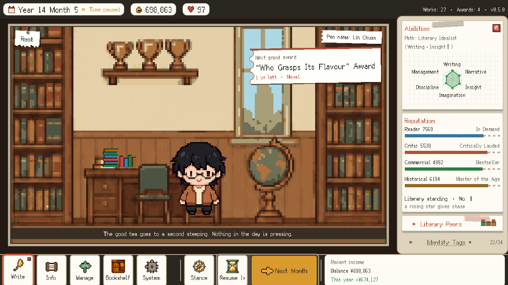

> **Source code is private.** This repository is a project write-up: what the game is, how it was designed,
> how it is built and tested, and the problems I had to solve. Read-only access to the source can be
> arranged for hiring purposes — see [Source Code & Contact](#source-code--contact).

## Contents

- [Overview](#overview)
- [Project at a Glance](#project-at-a-glance)
- [Key Features](#key-features)
- [Screenshots](#screenshots)
- [Design Approach](#design-approach)
- [Technical Architecture](#technical-architecture)
- [Challenges & Solutions](#challenges--solutions)
- [Testing & Quality](#testing--quality)
- [Playtest-Driven Iteration](#playtest-driven-iteration)
- [AI-Assisted Development](#ai-assisted-development)
- [What I Learned](#what-i-learned)
- [Status & Roadmap](#status--roadmap)
- [Source Code & Contact](#source-code--contact)

---

## Overview

You play a novelist across fifteen in-game years (180 months): choose what to write, decide where to send it,
watch it succeed or fail, and live with the career that results. It is inspired by Kairosoft's *Game Dev
Story*, but the central decision is an **aesthetic** one — *what is this book about, and how is it told* —
and the numbers exist to give that decision consequences.

**My role:** sole developer — game design, systems programming, UI, tooling and test infrastructure, and the
game's Chinese prose (with English and Japanese localization). Pixel art was produced with image-generation
tools against a written art bible and then integrated, cut and palette-checked by scripts I wrote.

**Timeline:** design and prototyping from December 2025; the current repository's history runs from June
2026 to today (1,440 commits).

## Project at a Glance

| | |
|---|---|
| **Engine / language** | Godot 4.6 · GDScript, statically typed |
| **Code** | 271 scripts · ~101k lines — ~65k game, ~36k test probes and tooling · 56 scenes |
| **Architecture** | 21 gameplay systems · 4 autoload singletons · event-bus messaging · 10 architecture decision records |
| **Content** | 65 JSON data files · 2,911 localized strings × 3 languages · ~100,000 characters of Chinese prose |
| **Game content** | 532 curated genre × theme × style compatibility rows · 119 work traits · 24 publishing channels · 21 endings · 54 achievements · 3 NPC storylines with 100+ conditional beats |
| **Design docs** | 20 system design documents (GDDs) |
| **Quality** | 10-stage automated test harness on every push (Linux CI) · 100 logged playtest rounds |

## Key Features

- **Three-axis creation** — every book is a choice of *genre × theme × style*, backed by 532 hand-curated
  compatibility rows in four tiers (*in tune / promising / bold / awkward*). Bold is not worse than in-tune;
  it is higher variance. Compatibility is knowledge you earn by writing, not a stat you read off.
- **A work is six numbers, not one** — prose, structure, character, substance, resonance and innovation,
  shaped month by month while you write.
- **Publish after you write** — the manuscript exists before you choose a channel: a literary magazine,
  a web-serial platform, a blog, the community notice board. Holding a finished book back is a real strategy.
- **Four reputations that disagree** — readers, critics, commercial and historical standing move
  independently and sometimes against each other.
- **Two literary worlds** — a serious-fiction track with juried awards and a web-serial track with
  subscriptions, monthly vote boards and platform ranks, each with its own economy.
- **Award seasons are played, not announced** — your book and a rival's are overlaid on one radar, weighted
  by that award's rubric, and seven judges vote.
- **People, not quest givers** — a mentor, a friend and a rival whose storylines are triggered by
  conditions, never by a timeline, and bend around the kind of writer you have actually become.
- **21 endings** decided by what you wrote over fifteen years, with a live "keep writing like this →"
  forecast on screen.
- **Fully keyboard/controller playable**, trilingual (Chinese / English / Japanese), four UI themes.

## Screenshots

<table>
<tr>
<td width="50%">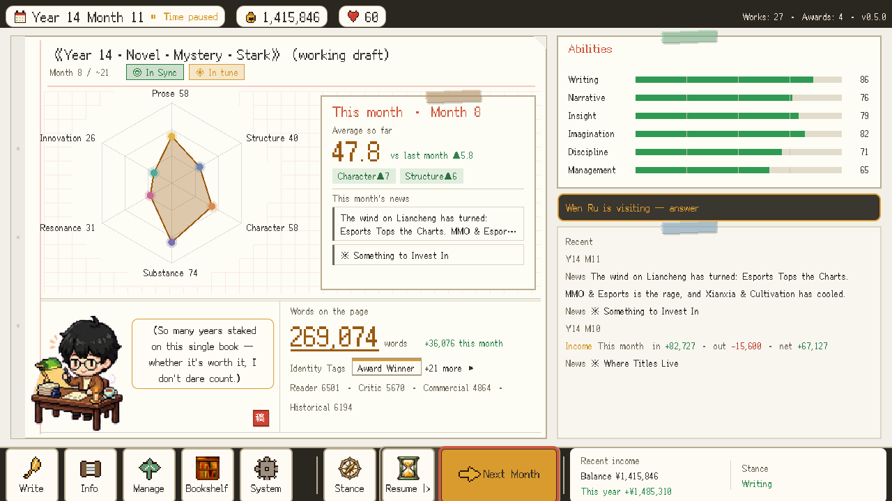</td>
<td width="50%">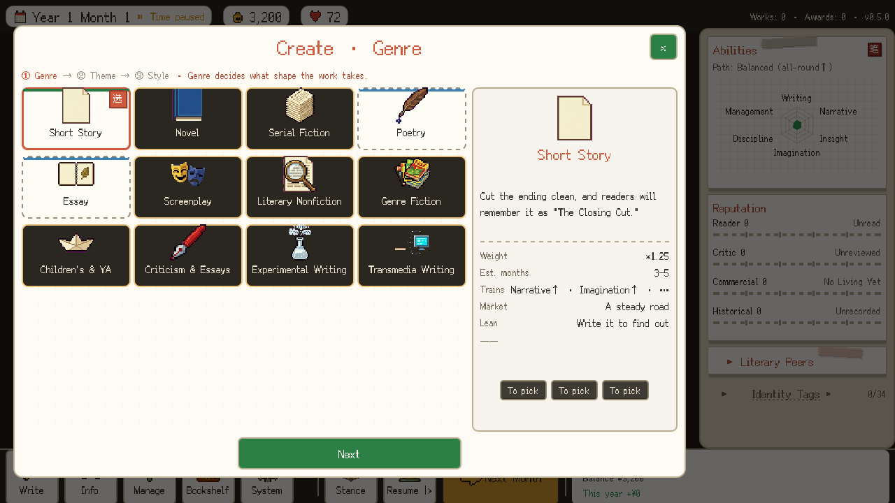</td>
</tr>
<tr>
<td><b>Writing a book.</b> The six-dimension radar grows month by month; the "this month" card shows what
moved and why. Abilities, word count and the month's news sit around it.</td>
<td><b>Choosing a genre.</b> Twelve genres, most locked on day one — progression is gated by what you have
actually written, not by a level.</td>
</tr>
<tr>
<td>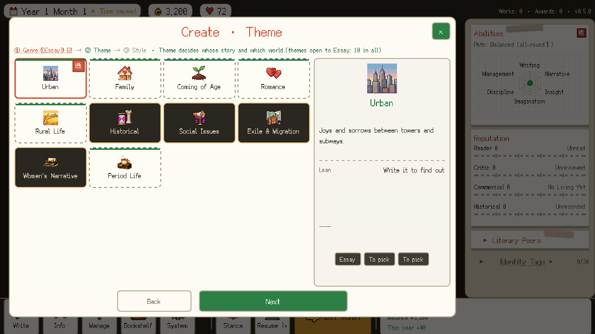</td>
<td>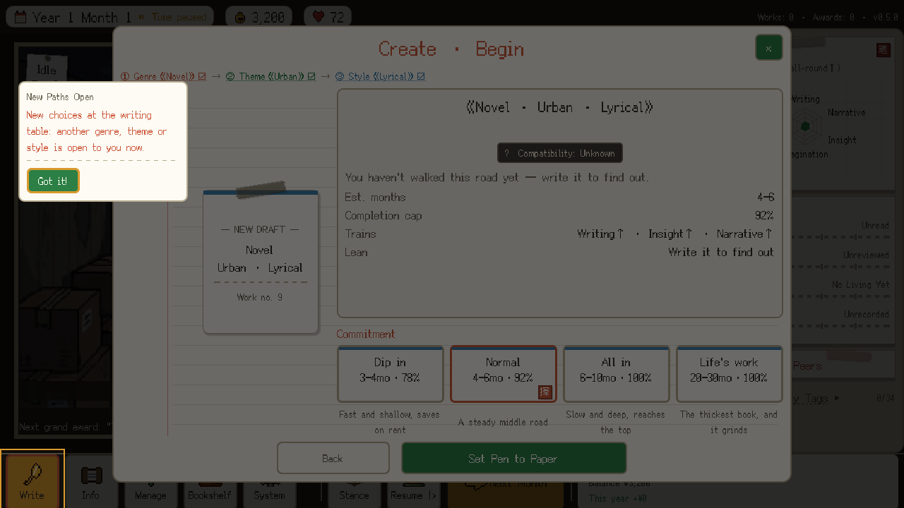</td>
</tr>
<tr>
<td><b>Each axis narrows the next.</b> The theme list is scoped by the genre you just picked — this is why
creation is a wizard, not three dropdowns.</td>
<td><b>The commitment step.</b> "Compatibility: unknown — write it to find out." Length and ambition set
the completion ceiling. The small card is a one-time teaching card.</td>
</tr>
<tr>
<td>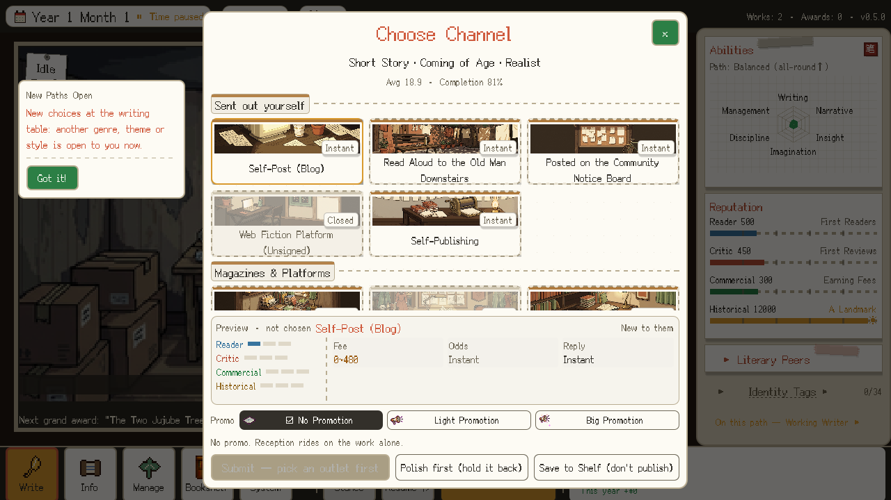</td>
<td>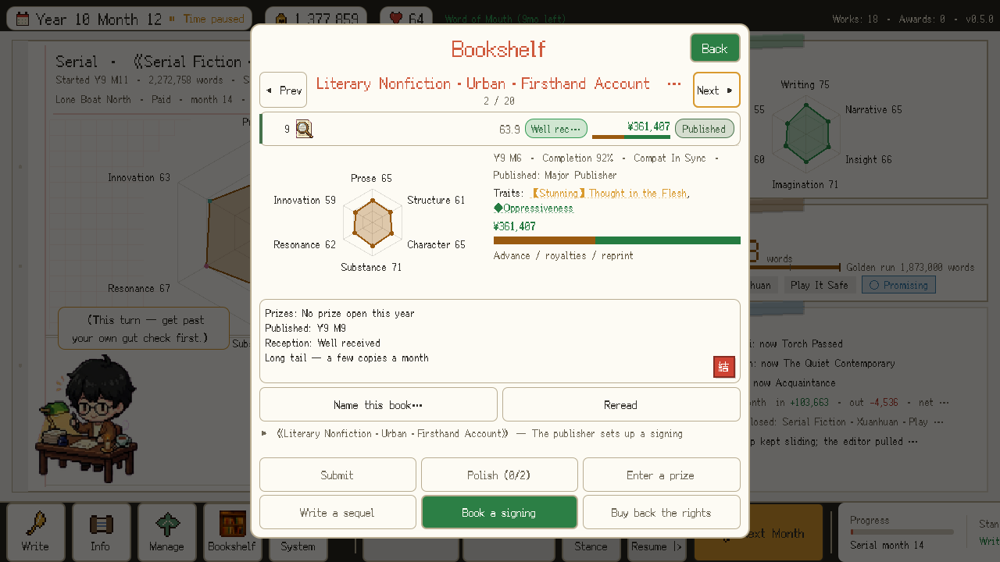</td>
</tr>
<tr>
<td><b>Where to send it.</b> Channels are places with personalities, not rungs on a ladder. "Polish first"
and "Keep it on the shelf" are real options.</td>
<td><b>Every book keeps a file</b> — scores, income by stream, prizes it can still enter, and six verbs for
what you can still do with it. A greyed verb says why.</td>
</tr>
<tr>
<td>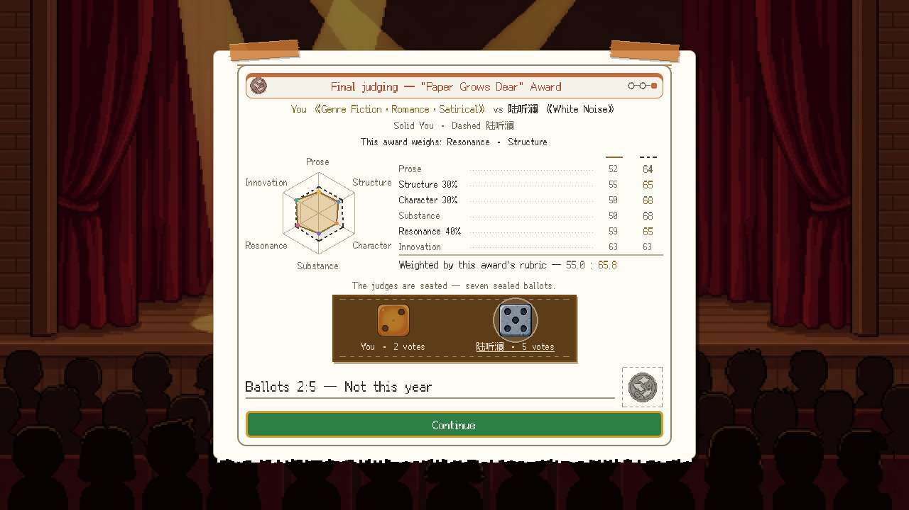</td>
<td>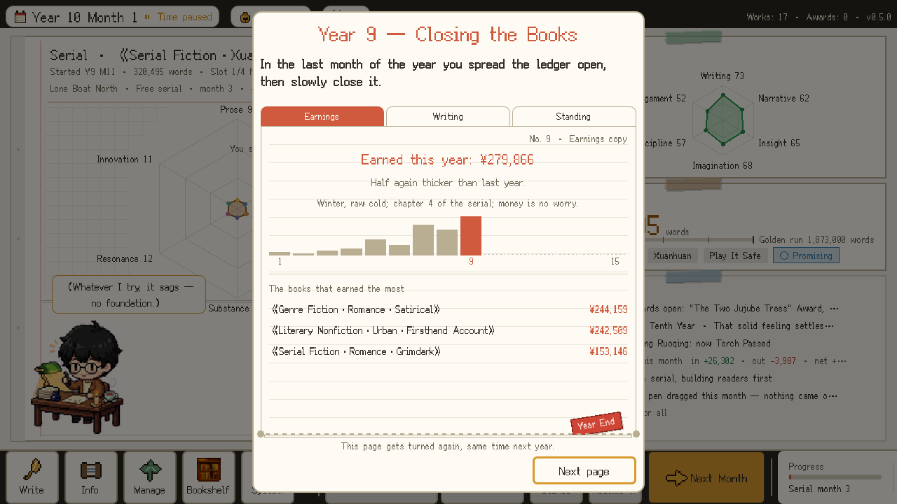</td>
</tr>
<tr>
<td><b>Final judging.</b> Both books on one radar, weighted by the award's rubric; seven sealed ballots.
This one lost 2–5, and the screen shows exactly where.</td>
<td><b>Each December the year is closed like a ledger</b> — earnings by book, words written, standing.
Fifteen of these pages make the career.</td>
</tr>
<tr>
<td>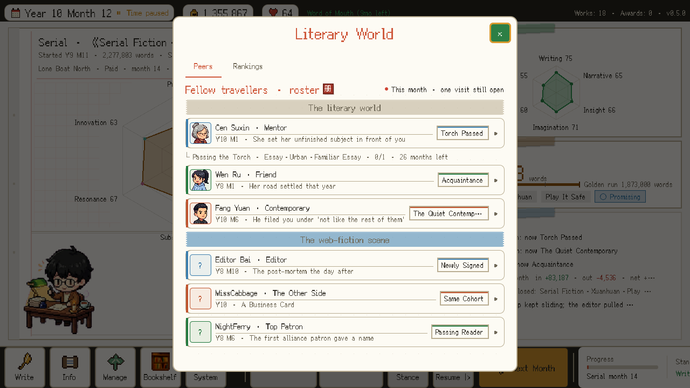</td>
<td>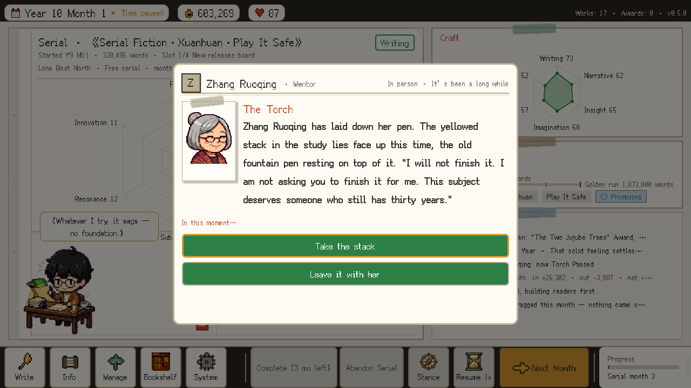</td>
</tr>
<tr>
<td><b>The literary world.</b> The game infers which lane you are in from your recent books (with
hysteresis, so one experiment does not relabel you), and the storylines follow.</td>
<td><b>A story beat.</b> About a hundred of these across three relationships, each gated by conditions on
your actual career.</td>
</tr>
<tr>
<td>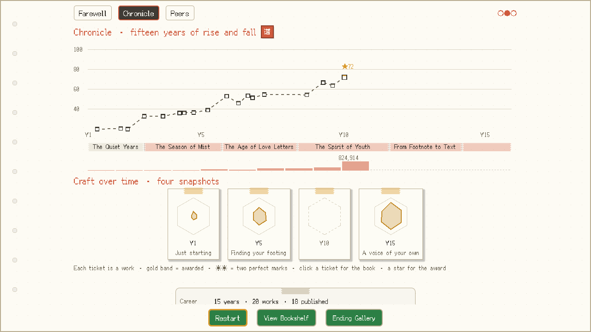</td>
<td>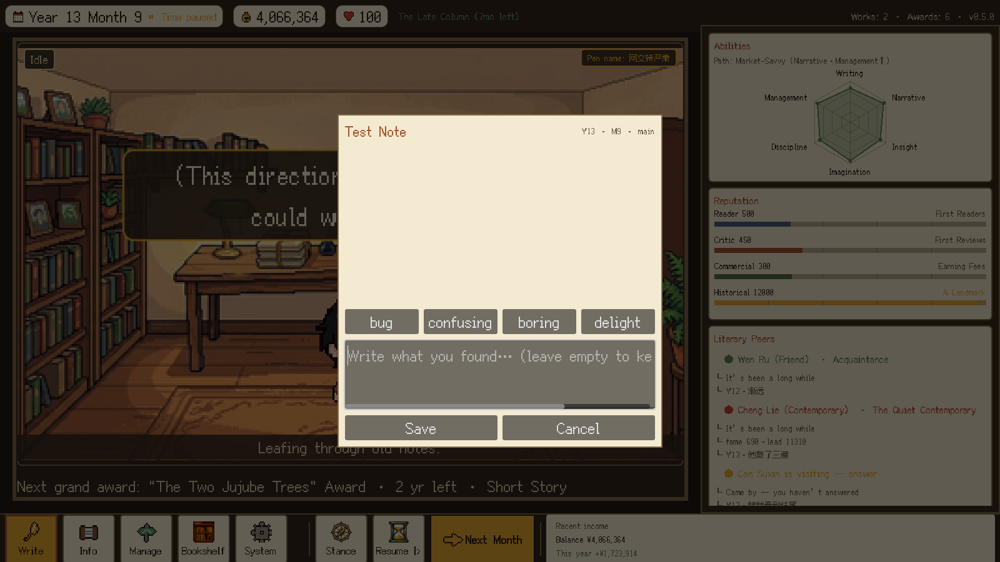</td>
</tr>
<tr>
<td><b>The chronicle.</b> Every published book is a ticket on the curve and every award a star; each
opens that book's file. The fifteen-year shape is only visible from here.</td>
<td><b>Tooling I built for myself:</b> one key during play opens a tagged note that attaches a screenshot
and a full save of the game at that instant. All 100 playtest rounds went through it.</td>
</tr>
</table>

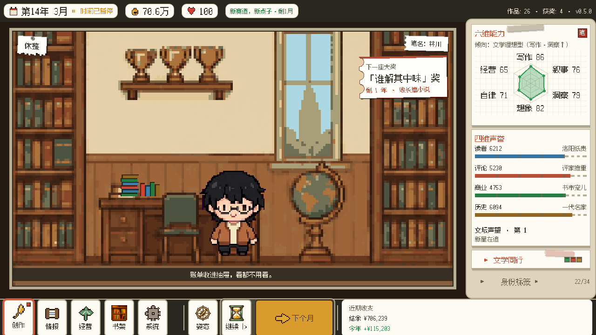 
The same study in Chinese, the game's native language. Labels measure themselves per language at
runtime, and the layout gate re-runs for every locale.

## Design Approach

**Pillars**

1. **The interesting decision is aesthetic.** Most career sims are optimization games wearing a theme.
   Writing does not feel like solving for a maximum; it feels like choosing what to be about and then
   finding out what the world does with it.
2. **The shape appears in retrospect.** Individual months are small; fifteen years make a story you can
   only read from the end — the ledger pages, the chronicle and the endings are built around that.
3. **Explain in the game's own voice.** Cards carry a line of character instead of a stat block, and
   mechanics are taught the first time they matter, then never again.

**Process.** Concept → system decomposition → one design document per system → architecture decision
records → implementation. On a solo project the documents are not for handover; they are where
contradictions surface before code hides them behind plausible arithmetic, and they give an AI agent
something its output can be checked against. A design document with an out-of-date number is treated as a
defect: any change to behavior updates its document in the same commit, and several automated checks
enforce specific cases of that rule.

## Technical Architecture

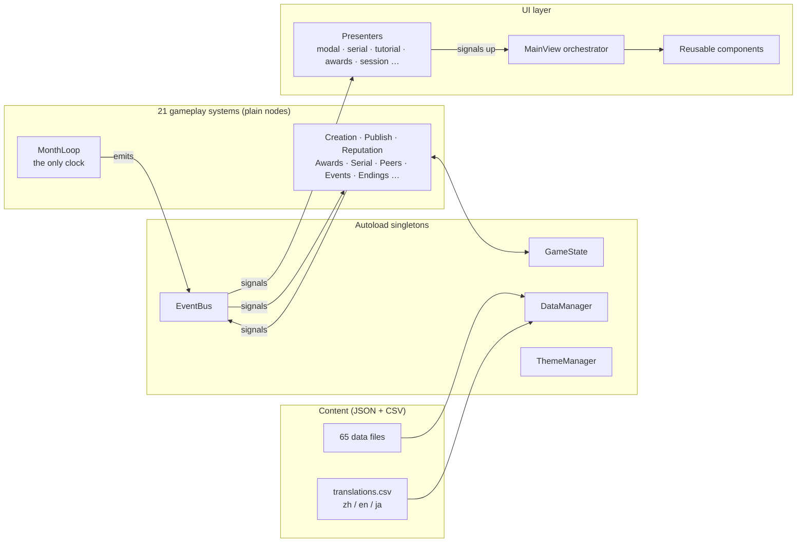

- **Systems never call each other.** Each gameplay system is a standalone node in its own file and talks
  only through signals on the event bus. The month loop is the only clock. Any system can be exercised in
  isolation by emitting the signals it listens for — which is exactly what the test harness does.
- **UI is a separate layer.** Screen controllers never reach into gameplay systems; they listen to the same
  bus and send signals up to one orchestrating view. As that view grew, cohesive slices were extracted into
  presenters, enforced by a per-file line-count ceiling in CI.
- **Content is data.** Genres, themes, styles, traits, events, channels, endings, achievements and the NPC
  storylines all live in JSON. Trigger conditions are strings (`works_published>=2 and signed_ever>=1`)
  interpreted by **one shared condition evaluator** with one vocabulary, and a lint gate rejects unknown
  terms at build time — a typo in a data file fails the build instead of silently making a story beat
  unreachable.
- **Localization is structural.** Every player-visible string goes through `tr()` from the first line of
  code. The CSV is the only source of truth in git; compiled translation binaries are regenerated on every
  import and never committed.
- **Determinism where it matters.** Market eras, monthly rankings, award fields and opponents are pure
  functions of `(seed, month)`, so a reopened window shows the same numbers and a bug at month 94 can be
  replayed from month 1.
- **A prose round trip.** All ~100k characters of Chinese text (spread over a CSV and dozens of JSON files)
  export into 38 readable "books" grouped the way a reader would group them; edits import back to the exact
  source field, with conflict detection, and are queued for English and Japanese.

## Challenges & Solutions

Real problems from this project, each with what caused it and what now prevents it from coming back.

**1. Text that fit in Chinese broke in English and Japanese.**
*Problem:* English and Japanese strings are often much wider than the Chinese originals; labels clipped,
buttons grew, windows overflowed the screen. *Cause:* layout was verified by eye, in one language, at one resolution.
*Solution:* a **fit gate** that opens every window and multi-step flow at 720p, 1080p and ultrawide, once
per language, and fails if a window exceeds the screen, a label is clipped by its container, or the primary
button moves between steps. Fixtures must feed the *longest* real string — a gate fed short strings passes
while the real game breaks.

**2. "Edited the text, shipped the old text."**
*Problem:* changed strings sometimes did not appear in the build. *Cause:* compiled translation files were
committed, and could silently go stale. *Solution:* make the stale artifact impossible — the CSV is the only
committed source, and binaries are build products regenerated on every import. An entire bug class
disappeared without any new discipline.

**3. A window the player could not dismiss.**
*Problem:* rare soft-locks. *Cause:* two independent overlay systems (in-world windows and a modal queue)
could be open at once. *Solution:* a **modal-layer gate** that asserts the two stacks are mutually exclusive
across every sequence the game can produce.

**4. Keyboard players trapped or crashing.**
*Problem:* a keyboard-only playthrough found six unreachable controls, and one crash in which two
focus-containment nets fought over focus until the process died. *Solution:* the crash became an assertable
failure, and a **keyboard walker** now explores every surface using the engine's own focus resolution
(a BFS over focus neighbors), asserting each control is reachable. New windows must join its roster in the
same change.

**5. Balance drifting while every reading looked "fine".**
*Problem:* four consecutive changes were each "within tolerance of the last run" — and together moved the
difficulty by more than two points. *Solution:* the share of runs reaching a top-tier ending is the single
difficulty dial, measured over 480 scripted runs against a **ratified baseline stored as a file**: the
reference is the ratified centre, never the previous reading; three readings on the same side are a shift,
not noise; and changing a tuning file without re-measuring turns CI red.

**6. Save bugs that are invisible on a fresh save.**
*Solution:* a **save museum** — real saves from older builds, frozen and never regenerated, are loaded,
re-saved and played forward on every run. The save format is the one contract that crosses versions.

**7. A test that printed PASS because it had crashed.**
*Problem:* a probe hit a script error halfway, skipped every later assertion, and still printed its
success line. *Solution:* any script error in a gate's output is a failure, and every gate reports a
heartbeat — how many checks it actually reached — so "green" has to be earned.

**8. A recent example, start to finish: "Why are all the opponent's scores 36?"**
A playtester noticed that early-game award opponents had six identical scores. *Root cause:* the award
screen borrowed its opponent "shape" from the sparring system, which had later gained an absolute floor of
50 — early-game players sit below it, so all six dimensions were clamped flat before being scaled. A tuning
change in one system had leaked into another through a shared helper. *Fix:* the award screen now builds
its own shape, and a test asserts the six dimensions are never flat; the test was confirmed to fail with
the fix removed before the fix was accepted. The same pass found an older test that only passed because a
55% random roll happened to miss — it now fails or passes deterministically.

**9. A tutorial that did not teach the essentials.**
*Problem:* reviewing the onboarding as a first-time player showed that money, morale, the calendar and the
fifteen-year goal were never highlighted, and that "skip tutorial" also silenced every future hint.
*Solution:* the guided rail grew from 32 to 34 steps with spotlights on those four HUD elements; skipping
now asks whether to keep hints; lessons only the rail used to teach gained fallback cards that fire only
for players who skipped; and four new first-encounter cards cover the remaining gaps. A scripted walker
clicks through all 34 steps on every CI run.

## Testing & Quality

One command runs the whole gate in about three minutes and returns a meaningful exit code; CI re-runs it
on Linux for every push to catch what one macOS machine cannot (case-sensitive paths, uncommitted assets,
build products that only regenerate from a clean clone).

| Stage | What it proves |
|---|---|
| Logic sweep + boot | White-box assertions over every system, headless; the main scene loads clean |
| Fit gate × 3 languages | Every window fits at 720p / 1080p / ultrawide in zh, en and ja |
| Modal-layer gate | The two overlay stacks are never open together |
| Focus gates | Reproduced focus crash stays fixed; every control is keyboard-reachable |
| Screen-vs-data oracle | What a screen *says* matches what the data layer *computes* |
| Tutorial walker | All 34 guided steps, with real clicks — spotlight on the right control, click lands where the screen says |
| Save museum | Old saves load, re-save and play forward |

Alongside it, a **scripted player** plays complete fifteen-year runs headlessly from fixed seeds. It drives
the **balance** measurement above, a **coverage matrix** of which content actually fired across thirteen
play styles (content silent for two campaigns goes on an orphan list), and a **narrative-consistency
oracle** that captures every line shown to the player with the world state at that instant and fails the
run on contradictions — "you've stopped writing" mid-manuscript, a prize congratulated before the ceremony,
the same sentence twice on one screen.

**Content lints** cover what code tests miss: orphaned translation keys, generated docs out of sync with
sources, pronouns that disagree with a character's recorded gender in any of three languages, text below a
contrast ratio, and author to-do notes left in player-facing fields.

## Playtest-Driven Iteration

The game has been through **100 logged playtest rounds**. The loop:

1. Play and write down what is wrong — as a player, in plain language, with the in-game logger (note +
   screenshot + full save attached).
2. Turn each complaint into a claim that can be false: *"the rival feels distant"* becomes *"does any code
   path raise this relationship above 40?"*
3. Reproduce from the attached save, find the root cause, fix it once in the shared code.
4. **Pin it:** a fix is not done until a check fails without it.
5. Update the design document in the same commit.

Because every note carries a complete save, "something felt off around year twelve" becomes a reproducible
case — the screenshots on this page were taken by loading those saves.

## AI-Assisted Development

The project was built with **Claude Code** as the primary development agent — a workflow where an agent
does most of the typing and I do the specifying, adjudicating and verifying.

- **Parallel agents for breadth** (one per subsystem, instructed to cite file and line and to say "not
  found" rather than guess); their findings are leads, verified before acting.
- **Persistent project memory** of rules and past mistakes, so lessons survive across sessions and models.
- **A live inspection bridge** into the running game, so the agent reads real runtime state and takes real
  screenshots instead of reasoning about what the code probably does.
- **Model roles:** Opus for architecture, debugging and review; Sonnet for mechanical volume; Fable for
  prose drafts, which I then edit to hold one voice across thousands of short pieces. Early on I also ran
  **Qwen3 4B locally on Ollama** for translation, and learned where a small model's context limit ends its
  usefulness.

**Where it is confidently wrong** — real cases from this repository: a sync script that assumed a key order
and shifted every entry in one file by one; a lint rule too loose on its first run; agents trusting a stale
design note over the code; a shell pipeline that swallowed a failing exit code and reported green; six
flagged items whitelisted "as reviewed" when one was the exact bug the gate existed for. None of them were
syntax errors — each was internally consistent and wrong about a fact nobody re-checked. That is why the
project's working rules are: a fix is done only when a wrong number is observably right; a new gate must
be broken on purpose and seen to fail before its green is believed; and when an instrument reports
something implausible, suspect the instrument first.

The leverage is real — this is far larger and better tested than anything I could have built by hand in
the same time — but it moves the human's job upstream: deciding what is true, and building the machinery
that keeps proving it.

## What I Learned

- **Design for the decision, not the numbers.** Making the core choice aesthetic changed everything
  downstream — UI copy, progression gating, even how failure is presented.
- **Tests are a product.** Every harness stage exists because a bug of that class reached a playtest; the
  harness went from 5 stages / 18 seconds to 10 stages / ~3 minutes, and each addition was earned.
- **Make bad states unrepresentable before adding discipline.** Removing committed translation binaries
  beat any checklist.
- **A gate you have not seen fail is decoration.** Negative-testing every new check caught several that
  could never have gone red.
- **Shared helpers carry hidden coupling.** Most of the hardest bugs were a change in one place quietly
  altering another through code they both borrowed.

## Status & Roadmap

- ✅ Playable end to end: all 180 months, 21 endings, both literary tracks, three NPC storylines.
- ✅ Trilingual UI, keyboard/controller support, four themes, Windows and macOS export pipeline, Steam
  integration wired.
- 🔧 In progress: balance pass after a full human playthrough, minimal audio package, native-speaker
  proofreading for English and Japanese.
- 🗓 Planned: Steam store release.

## Source Code & Contact

The source code and art assets are **not public**; this repository contains only this write-up and
screenshots. Read-only access to the private repository can be provided on request for hiring purposes,
and I am happy to walk through any system — the test harness, the data-driven content pipeline, the
localization setup, or the NPC storyline engine.

**Bowen Li** · [github.com/Bli18](https://github.com/Bli18)
