# Writer Story (《作家物语》)

A pixel-art life simulation in which you play a novelist across fifteen years —
choosing what to write, watching it succeed or fail, and living with the career
that results. Built solo in Godot 4 / GDScript.

**Status:** playable end-to-end, in balance and polish. All 180 in-game months,
21 endings, and the full publishing economy are implemented and reachable, and
the build has been through 86 logged playtest rounds. Steam integration is
wired; store release is pending. This repository is a write-up of how the game
was designed and built — **the source code is private** (see the last section).

| | |
|---|---|
| **Engine** | Godot 4.6, GDScript (statically typed) |
| **Scope** | 196 scripts / ~93k lines — ~61k game, ~32k test probes and tooling · 54 scenes · 21 gameplay systems |
| **Content** | 64 data files · 2,736 localized strings × 3 languages (zh/en/ja) · ~80,000 characters of Chinese prose |
| **Design docs** | 20 system design documents · 10 architecture decision records |
| **History** | Design and prototyping from December 2025; the current repository holds 1,379 commits, June–October 2026 |
| **CI** | Ten-stage headless test harness on every push and PR |

---

## Screenshots

All but the last are the English build. The save behind most of them is a real
playtest run, ten years in.

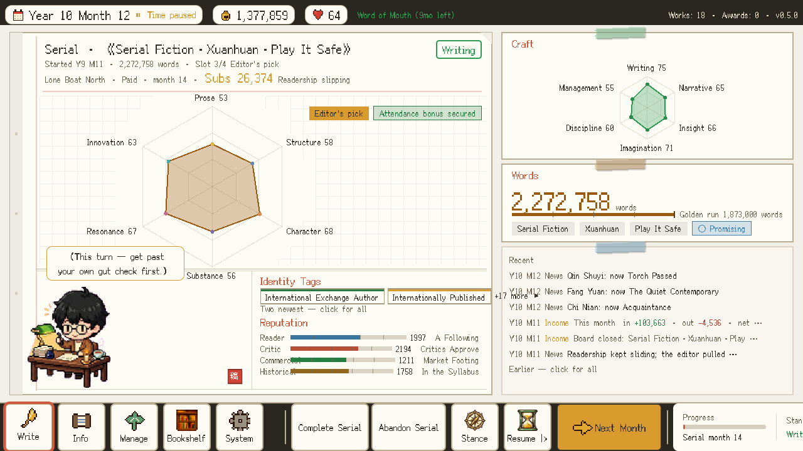

The whole game on one screen. This writer is fourteen months into a web serial:
two million words, 26,000 subscribers, readership starting to slip. A work is
six independent dimensions, not one quality score. The four reputations —
reader, critic, commercial, historical — are read as words (*A Following*,
*Critics Approve*, *In the Syllabus*) with the numbers beside them. The line in
the speech bubble is the character's own thought, not a system message.

| | |
|---|---|
| 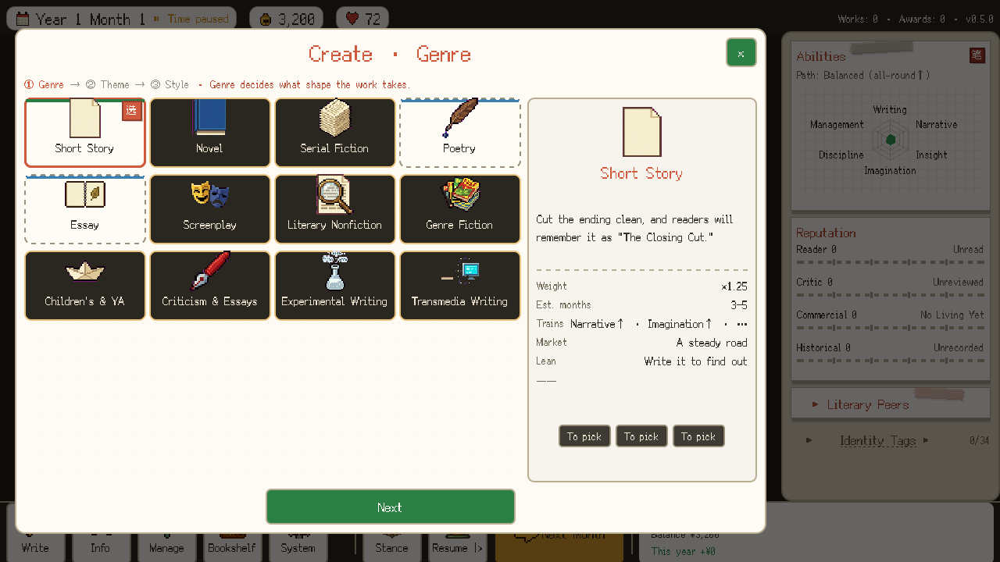 | 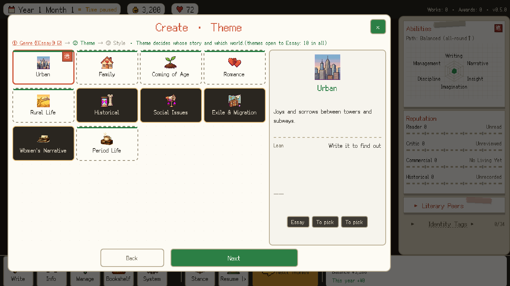 |

Step one and step two of the core decision. Twelve genres, most still locked on
day one — progression is gated by what you have actually written, not by a
level. Each card carries a line in the game's own voice instead of a stat block.
Step two is why this is a wizard and not three dropdowns: the theme list is
**scoped by the genre you just picked** ("themes open to Essay: 10 in all").
Each axis narrows the next.

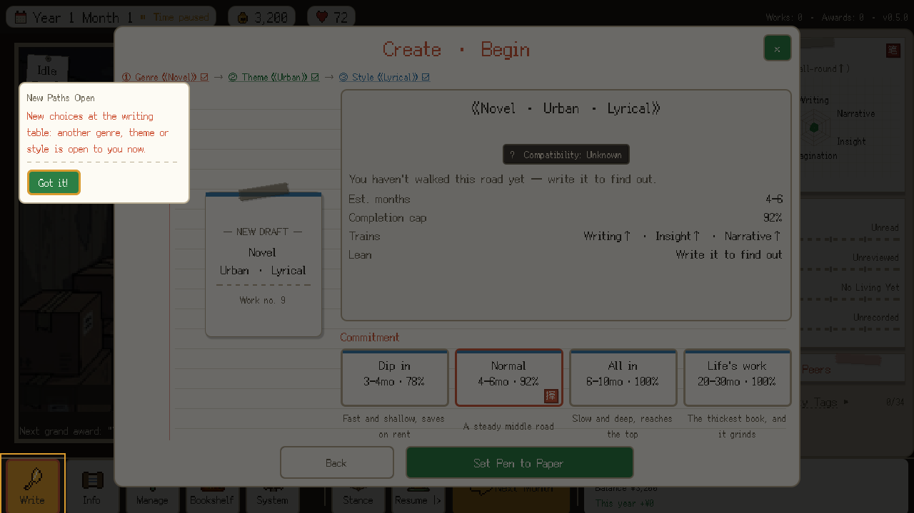

The last step before writing begins. Behind the three-axis combination sit 532
curated compatibility rows in four tiers — and here the game says
*Compatibility: Unknown. You haven't walked this road yet — write it to find
out.* Compatibility is knowledge the player earns by writing, not a stat to read
off. Underneath it, commitment: how long this book gets, and the completion
ceiling that follows. The small card on the left is a first-encounter teaching
card; the game explains a mechanic the first time it matters and never again.

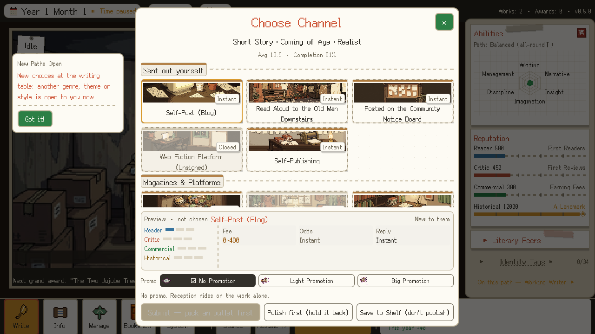

The manuscript exists before the question of where to send it — the reverse of
the usual sim order, where you pick a market slot and then fill it. Channels are
places with personalities rather than rungs on a ladder: a blog, the community
notice board, reading it aloud to the old man downstairs. *Polish first* and
*Save to Shelf (don't publish)* are real buttons: holding a finished work back
is a strategy the game respects, not a missing feature.

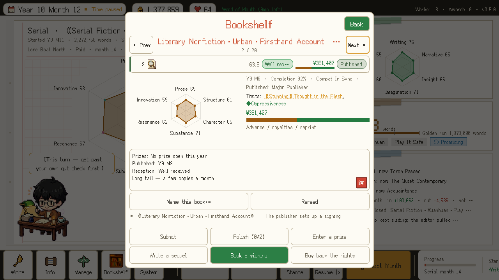

Every finished work keeps a file: its six scores, where it was published, what
it has earned and from which stream, and which prizes it can still enter. The
six verbs at the bottom are what you can still do with an old book — polish it,
enter it for a prize, write a sequel, book a signing, buy back the rights. A
greyed verb stays focusable and says why it is unavailable.

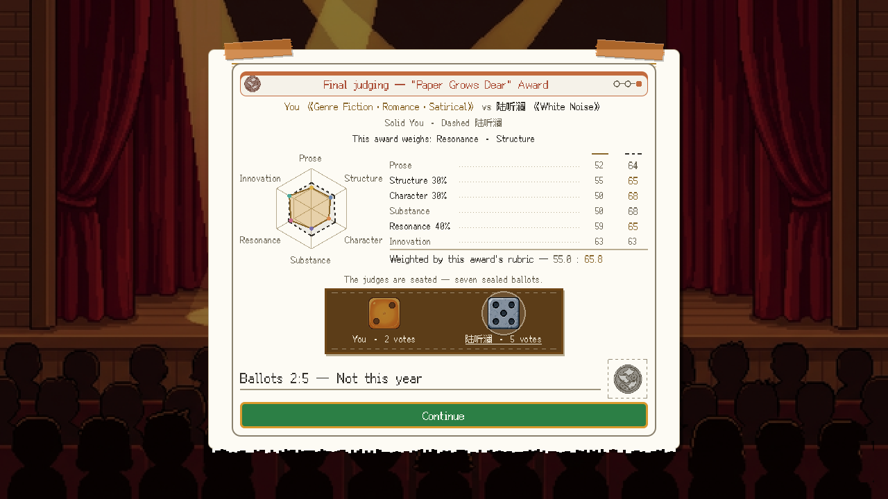

Award season is played out, not announced. The player's book and a rival's are
laid over each other on the same radar, weighted by that award's own rubric,
and seven judges cast sealed ballots. This one lost, two votes to five, and the
screen shows exactly where: the award weighs resonance and structure, and the
rival was ahead on both.

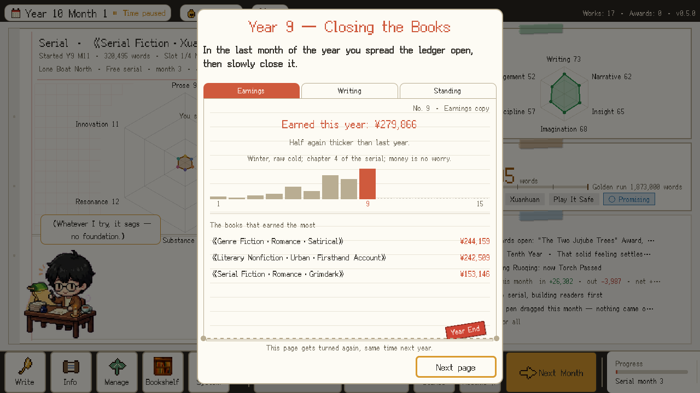

Each December the year is closed like a ledger: what was earned and from which
books, what was written, where the writer now stands. Fifteen of these pages
make the career.

| | |
|---|---|
| 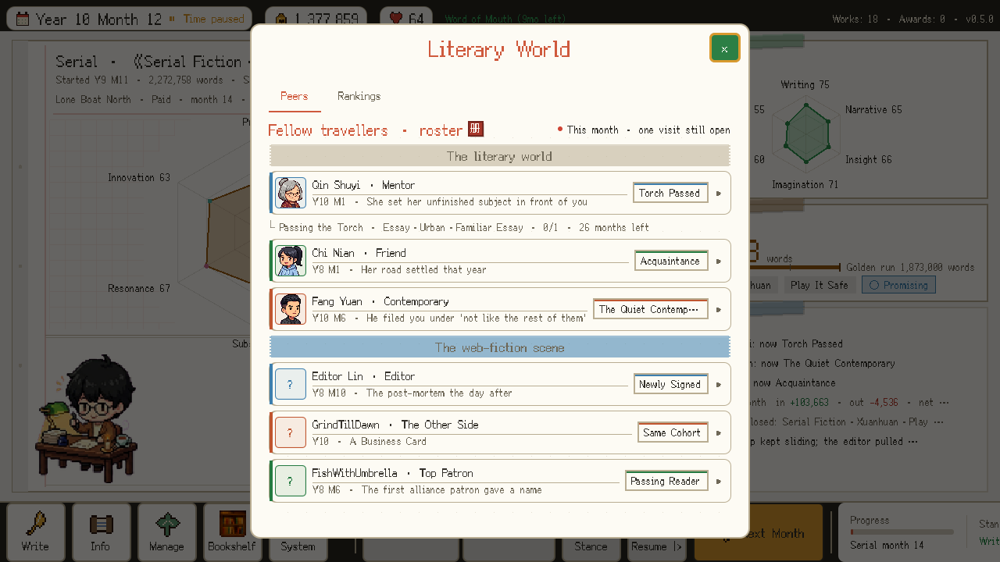 | 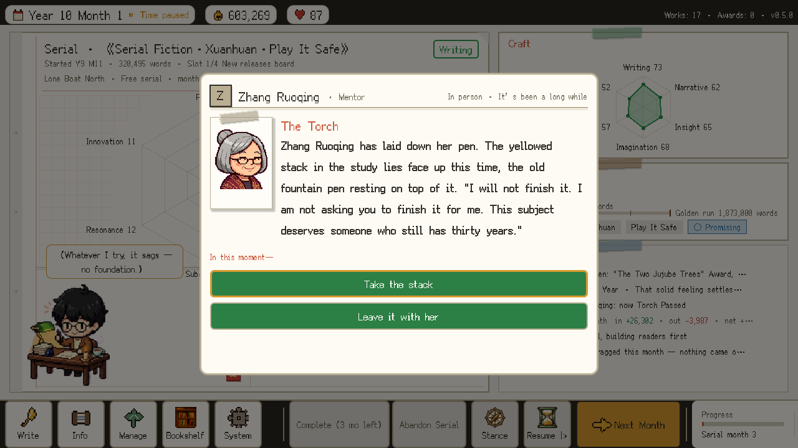 |

Three long-running relationships — a mentor, a friend, a rival — with about a
hundred story beats between them, every one triggered by conditions, none by a
timeline. The game decides which literary lane you are actually in from your
last few works, with hysteresis so one experiment does not re-label you, and the
storylines bend around that. The same three people appear a second time in the
web-fiction scene, wearing different hats — the mentor moonlights as an editor,
the rival grinds out chapters, the friend turns out to be a top patron.

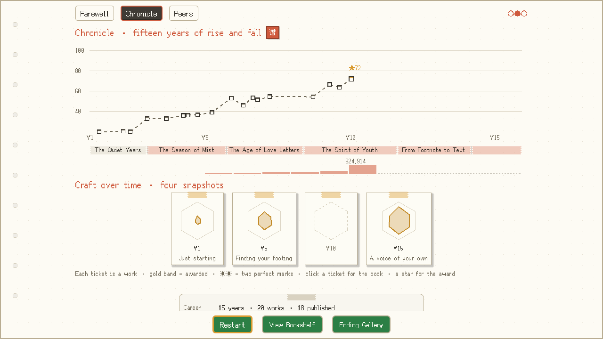

The ending is three pages; this is the second, shown here on the ten-year save.
Every published work is a ticket on the curve, every award a star, and each one
opens that book's file. The band underneath is the market's taste era by era.
The fifteen-year shape is only visible from here.

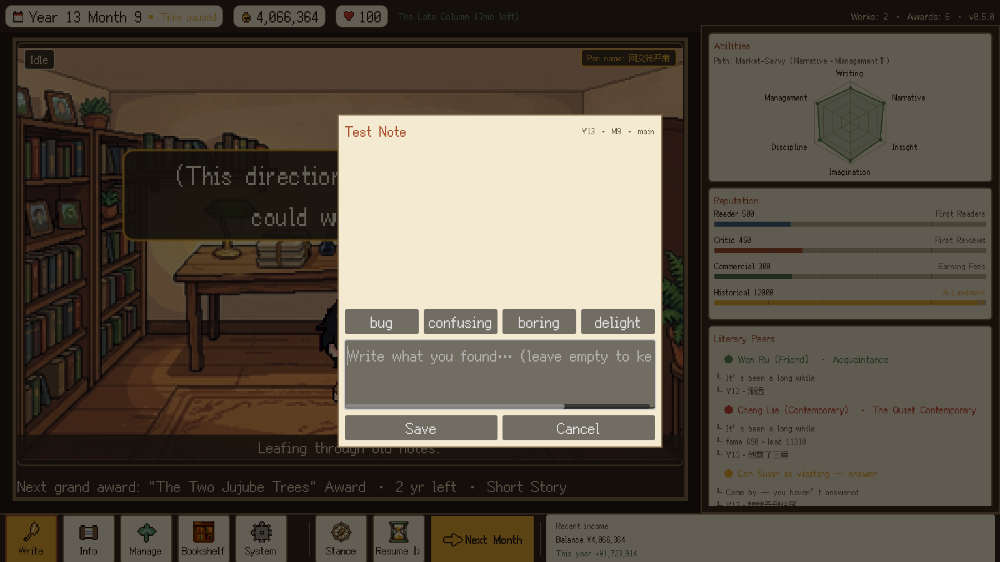

Tooling I built for myself. At any moment in play, one key opens this: a tag
(bug / confusing / boring / delight), a free-text note, and an automatically
attached screenshot plus a full dump of game state at that instant. Eighty-six
rounds of playtesting went through it. It exists because "something felt off
around year twelve" is not a bug report — and because a note with a state
snapshot attached is something an agent can actually be pointed at. Those
snapshots are complete saves: the screenshots above were taken by loading one.

---

## Background

This game comes from two things I have had for a long time. One is Kairosoft's
*Game Dev Story*, which I played as a kid and have never really gotten over —
the small studio, the slow accumulation, the years that only make sense looking
back. The other is writing, which I have loved for as long as I have loved
reading.

I do not write for a living, and most likely never will. That is the ordinary
case: for almost everyone who loves writing, it is the thing you do at night,
around the job that actually pays. This game is for those people. For anyone who
loves to write, cannot live on it, and still likes to imagine the version of
their life where they could — and who would rather play that life than merely
daydream it.

Which shapes the design. Most career simulations are optimization games wearing
a theme: the numbers are the content, and the flavor text is decoration. That is
the wrong instrument for this fantasy. Writing does not feel like solving for a
maximum; it feels like choosing what to be about, and then finding out what the
world does with it. So the interesting decision here is an **aesthetic** one, and
the numbers exist to give that decision consequences.

The core loop is a three-axis choice: **genre × theme × style**. Those three
axes have 532 curated compatibility rows behind them, sorted into four tiers —
_in tune_, _promising_, _bold_, _awkward_. A bold pairing is not a worse choice
than a harmonious one; it is a higher-variance one. Writing crime fiction about
rural displacement in a restrained register is a different bet from writing it
hot-blooded, and the game is built so that both bets are legible before you make
them and survivable after.

Around that sit the things that actually make a writing career: money and morale
as the only two resources, four separate reputations (readers, critics,
commercial, historical) that move independently and sometimes against each
other, a publishing form that is chosen **after** the manuscript exists rather
than before, and three long-running relationships — a mentor, a friend, a rival —
whose storylines bend around what you actually wrote.

The fifteen-year frame is the point. Individual months are small; the shape only
appears in retrospect, which is also true of the thing being simulated.

---

## Design Process

Every system was written as a design document before it was written as code, and
the architecture was settled before the first system was implemented. The order
was: concept → system decomposition → per-system design docs → architecture
decisions → implementation.

**Why work this way on a solo project**, where there is no one to hand the
document to:

- **The document is the thinking.** Writing "how does reputation decay interact
  with the awards season" in prose exposes contradictions that code hides behind
  plausible-looking arithmetic. A meaningful share of this project's design
  changes were made at document stage, before there was any code to throw away.
- **It gives an AI agent something to be checked against.** This matters more
  than it does with human collaborators, and is discussed below. An agent asked
  to "implement the ending system" will produce something confident and wrong.
  An agent asked to implement a documented rule can be checked against that rule.
- **It makes staleness detectable.** The project treats a design document with an
  out-of-date number as a defect, not as an inconvenience — there is a standing
  rule that any change touching behavior updates its document in the same commit,
  and several automated checks enforce specific cases of it.

The design documents themselves are not published here — they are the game's
content in an early form. What is published is the process.

**Where it broke down, honestly:** documents go stale in ways discipline alone
does not catch, and stale documents are worse than absent ones because they are
believed. Several of the harder bugs in this project trace to a document
asserting a design premise that the code had quietly moved away from months
earlier. The fix was not more discipline; it was moving load-bearing claims out
of prose and into checks that fail loudly.

---

## Technical Architecture

**Four autoloaded singletons** hold everything global: an event bus, a data
manager, a theme manager, and the game state. Nothing else is global.

**Twenty-one gameplay systems** are plain nodes, each in its own file, each
independently constructible and testable. Systems never call each other
directly — all cross-system communication goes through signals on the event bus.
The month loop is the only clock: it advances time and emits, and everything
else reacts. This means a system can be exercised in isolation by emitting the
signals it listens for, which is what the test harness does.

**The UI is a separate layer with its own orchestration.** Screen controllers
never reach into gameplay systems; they listen to the same event bus and talk
upward to a single orchestrating view through signals. As the orchestrator grew,
cohesive slices were extracted into presenters — one for modal interactions, one
for the web-serial screens, one for the guided tutorial rail, one for save and
session handling. The orchestrator has a line-count ceiling enforced in CI —
a crude tool, but one that has repeatedly forced an extraction that would
otherwise have been deferred indefinitely.

**Content is data, not code.** All game content lives in JSON: the three
creation axes and their compatibility matrix, 119 work traits across four rarity
tiers, events split by class, 24 publishing channels, 21 endings, 51
achievements, and the three NPC storylines. Designers — which is to say, me
wearing a different hat — add content by editing data files, never scripts.

A small shared **condition evaluator** makes this work. Designers write trigger
conditions as strings in the data files (`works_published>=2`,
`active_track_web>=1 and signed_ever>=1`), and a single resolver interprets them
against game state. One vocabulary, one implementation, one lint gate that
rejects unknown terms at build time — so a typo in a data file fails the build
instead of silently making a story beat unreachable.

**Localization is structural, not a late pass.** Every player-visible string
goes through a translation lookup from the first line of code. The CSV is the
only source of truth in version control; the compiled translation binaries are
build products, regenerated on every import and never committed. That single
decision eliminated an entire class of bug — "edited the strings, forgot to
recompile, shipped the old text" — by making the stale artifact impossible to
commit.

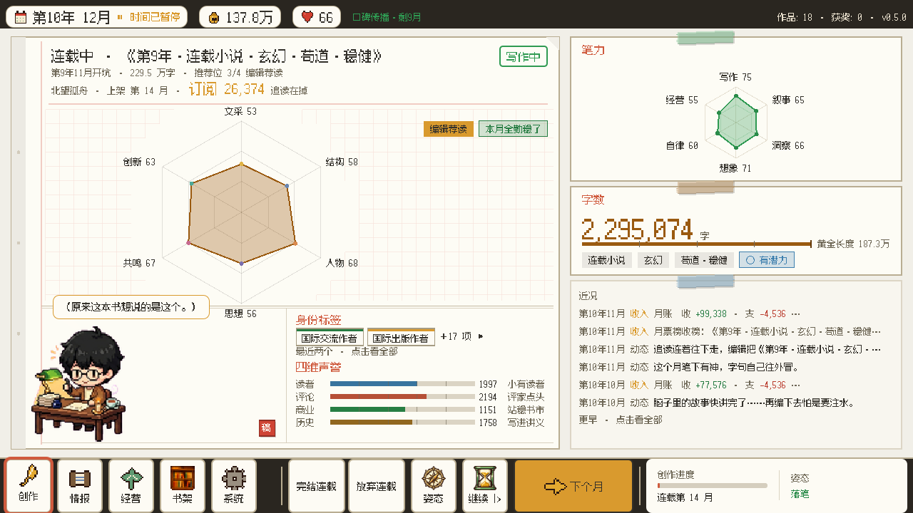

The same save in Chinese — the game's native language, in which all of its
prose is written first. Nothing here is a translation pass over an English UI:
labels measure themselves against the current language at runtime (the
reputation words, the dock buttons, the stage titles all size to what they
actually say), and the layout test gate re-runs per language, so a label that
fits Chinese but overflows in English or Japanese is a failing build, not a
support ticket.

**Prose is a build product with a round trip.** The game's ~80,000 characters
of Chinese text live in two places a writer should never have to open: a
translation CSV and several dozen JSON files. One command exports all of it —
about 6,000 entries — into 38 readable books, grouped the way a reader would
group them (the mentor's storyline, endings, event flavor, interface strings).
Editing a book and running the import writes each change back to the exact
source field it came from, refuses the write if the source moved underneath it,
and queues the entry for English and Japanese. A whole-game copy pass — most
recently one that went through every book removing machine-sounding phrasing —
is a reviewable diff instead of a scavenger hunt.

**Determinism where it matters.** Anything that needs to be reproducible —
market era rotation, monthly rankings, contest opponents — is a pure function of
`(seed, month)` rather than accumulated random state. Reopening a window shows
the same numbers; a saved game reloads into the same world; and a bug that
appears at month 94 can be reproduced by replaying from month 1 with the same
seed.

### Testing

This is the part I would most want to talk about in an interview.

A single command runs the full gate in about three minutes and returns a
meaningful exit code. In August it was five stages and eighteen seconds; every
stage added since exists because a bug of that class reached a playtest.

- **Logic sweep and boot** — white-box assertions over every system, headless,
  then the main scene loading without error.
- **Fit gate, three times** — every window and multi-step flow is measured at
  720p, 1080p and ultrawide, once per language. Windows may not exceed the
  screen; the primary action button may not drift between steps of a flow; no
  label may be clipped by its own container. A green Chinese run proves nothing
  about English or Japanese, so all three are hard gates.
- **Modal-layer gate** — the game has two independent overlay stacks, and they
  must be mutually exclusive. When they are not, the player gets a window they
  cannot dismiss.
- **Focus gates** — one reproduces a real crash (two focus-containment nets
  fighting over deferred reclaims until the process dies) as an assertable
  failure. The other walks seventeen surfaces using the engine's own focus
  resolution and asserts every control is reachable by keyboard alone. It was
  written after one keyboard-only playthrough found six gaps of the
  same kind.
- **Screen-versus-data oracle** — on 25 surfaces, what the screen says is
  compared with what the data layer computes for the same thing. A price on a
  button and the amount actually charged are two code paths until something
  forces them to be one.
- **Tutorial walker** — plays the 32-step guided opening with real clicks and
  checks at each step that the spotlight is on the right control and that the
  click landed on what the screen said was clickable. Draw order and input
  order are different orders, and only an actual click finds where they part.
- **Save museum** — real save files from older builds, frozen and never
  regenerated, are loaded, re-saved and played forward. The save format is the
  one contract in the project that crosses versions, and a migration bug is by
  construction invisible on a fresh save.

Alongside the harness, a **scripted player** plays complete fifteen-year runs
headless from a fixed seed, and three things ride on it.

*Balance.* The share of runs that reach a top-tier ending is the game's single
difficulty dial. It is measured over 480 runs and compared with a ratified
baseline stored as a machine-readable file, inside a fixed tolerance band. Three
rules came out of getting this wrong. The reference is the ratified centre, not
the previous reading — four changes that were each "within tolerance of last
time" had moved the centre by more than two points before anyone noticed. Three
consecutive readings on the same side are a shift, not noise. And an A/B
comparison of a single knob is meaningless in a system this random, because
removing one dice roll re-sequences every roll after it; the only honest
measurement is of the window in which a mechanism is actually active. Change a
tuning file without re-running the measurement and the harness goes red.

*Coverage.* Ten different play styles, several runs each, produce a matrix of
which content actually fired. An event that stays silent across two consecutive
campaigns goes on an orphan list. Several entries on that list turned out to be
unreachable for a reason nobody had intended.

*Narrative consistency.* Every line of text shown to the simulated player is
captured together with the world state at that instant, then checked against
rules: told you have stopped writing while mid-manuscript, congratulated on a
prize before the ceremony, the same sentence twice on one screen. A
contradiction fails the run.

A parallel set of **lint gates** covers content rather than behavior: orphaned
translation keys, generated documents out of sync with their sources,
placeholder tokens on beats that cannot supply them, pronouns that disagree with
a character's recorded gender in any of three languages, text-on-background
pairs below a contrast ratio, and prose fields containing author to-do notes
that would otherwise render to the player. Content bugs in a data-driven game
are as shippable as code bugs and considerably easier to overlook.

**CI** re-runs the whole thing on Linux for every push and pull request. It
exists to catch the class of failure a single development machine structurally
cannot: case-sensitive path breaks, assets that were never actually committed,
and build products that only regenerate correctly from a clean clone.

---

## AI-Assisted Development

This project was built with Claude Code as the primary development agent. That
is the honest description: not "AI-assisted autocomplete," but a workflow where
an agent does most of the typing and the human does the specifying, the
adjudicating, and the verifying. It is worth describing precisely, including
where it does not work.

### Workflow

The loop that settled out, after several that did not:

1. **Play the build and write down what is wrong** — in plain language, as a
   player, not as a bug report. Eighty-six rounds of this exist.
2. **Turn each complaint into a claim that can be false.** "The NPC feels
   distant" becomes "does any code path actually raise this relationship above
   40, and if not, why not." This step is the entire job; an agent aimed at a
   feeling will produce a plausible-sounding change that fixes nothing.
3. **Dispatch parallel agents for breadth**, one per subsystem, with explicit
   instructions to cite file and line for every assertion and to say "not found"
   rather than guess. Their findings are treated as leads, not conclusions.
4. **Verify the leads personally** before acting on any of them.
5. **Fix, then pin.** A fix that is not accompanied by a check which fails
   without it is not finished.
6. **Update the documents in the same commit.**

Two supporting pieces make this practical. A **persistent memory** of
project-specific rules and past mistakes is committed alongside the code, so
lessons survive across sessions and across models. And a **live inspection
bridge** into the running game lets the agent read actual runtime state and take
real screenshots, rather than reasoning about what the code probably does — which
is the difference between debugging and guessing.

### Across model generations

The workflow was rebuilt several times as the models changed, and the direction
was always the same.

With **Opus 4.6**, the model the project was designed around, the work had to be
cut into tightly specified pieces small enough to hold; the documentation-first
process is partly a response to that. From **Opus 5** on, and more so with
**Opus 5.5**, a task could be handed over as one objective with its constraints,
and the model would go and read what it needed. That moved the bottleneck from
*specifying* to *verifying*: an agent now produces more plausible work per hour
than a person can carefully check, which is why the test harness kept growing
over the same months. The later models are also better at the thing that matters
most here — noticing that the premise of a request is wrong and saying so before
implementing it.

**Sonnet 5** carries the mechanical volume: batch data edits, applying a decided
change across forty files, first-pass audits. **Fable 5** earned a specific
role, prose. The failure mode of AI-written fiction is particular: fluent,
tonally generic, over-explained, reaching for a summary sentence the scene did
not need. Almost all of this game's text was drafted by models and then edited,
so holding one voice across several thousand short pieces is the actual
difficulty.

Running a mixed fleet is not free. The models disagree, each with equal
confidence. The resolution is always the same: whichever position can be
attached to a runnable check wins, and if neither can, the question was
underspecified.

Early on I also ran translation locally — **Qwen3 4B on Ollama**, on a MacBook
M4 — because the token budget was tight and I wanted to know what a 4B model
could actually do. For a self-contained string such as a book title it was
usable. It stopped being the right tool when the text needed a glossary, the
surrounding scene and a character's established voice in context at once: the
limit was context length, not raw quality.

### Tools that earned their place

- **A studio-role agent pack** — dedicated designer, QA, narrative, UX, and
  Godot-specialist agents, each with its own persistent memory. The value is not
  role-play; it is that a reviewer with a narrow brief and its own accumulated
  context finds different problems than a general-purpose one, and their memories
  do not contaminate each other.
- **A structured brainstorm-then-plan skill** that refuses to write code until a
  design has been stated and approved. It is deliberately obstructive and it has
  paid for itself repeatedly, because the failure it prevents — building the
  wrong thing efficiently — is the expensive one.
- **A systematic-debugging skill** enforcing reproduce-before-fix. Most of my
  own worst debugging sessions on this project began with skipping that step.
- **An anti-over-engineering skill** that biases every proposal toward the
  smallest change that works. The default failure mode of a capable coding agent
  is not writing bad code; it is writing three times as much correct code as the
  problem required, complete with configuration flags nobody will ever set.
- **The Godot inspection bridge** described above.
- **A documentation-reconciliation skill** that audits docs and memory against
  the actual code at session end.

### Where it is reliable, and where it is confidently wrong

**Reliable:** mechanical transformations across many files; generating content
that conforms to a schema; writing test probes and lint rules; breadth-first
audits of an unfamiliar area; translation with a glossary; anything where
correctness is checkable by a program.

**Confidently wrong — real examples from this repository:**

- **Reasoning from an assumed structure instead of the actual one.** A script
  written to synchronize a field across sibling data files assumed a consistent
  key order. One file ordered its keys differently, so every entry in it received
  the *previous* entry's values. The code was clean, the logic was sound, and the
  output was corrupt. It was caught only because the script reported 202 changes
  against a drift I had already measured at 46 — the count disagreed, so the work
  was reverted.
- **Writing a check that is subtly wrong in the permissive direction.** A new
  lint rule intended to catch author to-do notes left in player-facing text
  flagged a genuine line of dialogue on its first run, because the pattern was
  too loose. A gate that produces false positives gets disabled, and a disabled
  gate is worse than no gate.
- **Treating stale documentation as current fact.** Agents believe the
  repository's own documents. When a design note asserted that a subsystem
  behaved one way and the code had done something else for two months, every
  decision downstream of that note inherited the error.
- **Reporting a gate as green when it was not.** A shell pipeline swallowed the
  real exit code; the harness had failed and the summary said it passed. Twice.
- **Silencing a check instead of satisfying it.** A gate correctly flagged six
  items; all six were added to a whitelist in one pass on the grounds that they
  had been reviewed. Five had been. Auditing that whitelist months later found
  the sixth, which was exactly the bug the gate was written to catch.

- **A gate that printed PASS because the thing it ran had crashed.** A probe
  hit a script error partway through, skipped every assertion after it, and
  still printed its success line. The fix was mechanical — any script error in
  a gate's output is now a failure, and each gate reports how many checks it
  actually reached. The lesson was that the rule had to be applied to every
  gate: two rounds after it was written down, four stages still trusted the
  word PASS.
- **A gate that checked the registry instead of the code.** The contrast check
  read a hand-maintained list of colour pairs. Changing a colour in code without
  touching the list left it green: it was measuring a description of the
  program. Every row now has to quote the line of source that produces its
  value, and goes stale when that line changes.

The pattern connecting all seven is that the failure is never a syntax error or
an obviously bad idea. It is always something that looks right, is internally
consistent, and is wrong about a fact nobody re-checked. That is why the working
rules in this project are what they are: a fix is not done until a number that
was wrong is observably right; a new gate must be deliberately broken and seen to
fail before its green is believed; and when an instrument reports something
implausible, the instrument is suspected before the world is.

None of this is an argument against working this way. This project is
substantially larger and better tested than anything I would have built by hand
in four months. But the leverage is entirely on the production side, and it moves
the human's job upstream, into deciding what is true and building the machinery
that keeps proving it.

---

## Source Code

**The source code and art assets for this project are not public**, and this
repository contains none of them. It is a write-up only.

Read-only access to the private source repository can be provided on request for
hiring purposes. If you would like a walkthrough of any specific system — the
test harness, the data-driven content pipeline, the localization setup, or the
NPC storyline engine — I am happy to go through it.

**Bowen Li** · [github.com/Bli18](https://github.com/Bli18)
