

# 《作家物语》Writer Story

**一款像素风人生模拟游戏：扮演一位作家走完十五年写作生涯。由我一个人用 Godot 4 完成设计、编程与文案。**

[English](README.md) · **简体中文**

-355570)

> **源码不公开。** 本仓库是项目说明：游戏是什么、怎么设计的、怎么搭建和测试的，以及我遇到并解决的问题。
> 如因招聘需要，可提供私有源码仓库的只读权限，见[源码与联系方式](#源码与联系方式)。

## 目录

- [项目简介](#项目简介)
- [项目数据一览](#项目数据一览)
- [核心特色](#核心特色)
- [游戏截图](#游戏截图)
- [设计思路](#设计思路)
- [技术架构](#技术架构)
- [难题与解法](#难题与解法)
- [测试与质量保障](#测试与质量保障)
- [以试玩驱动迭代](#以试玩驱动迭代)
- [AI 辅助开发](#ai-辅助开发)
- [收获与心得](#收获与心得)
- [进度与计划](#进度与计划)
- [源码与联系方式](#源码与联系方式)

---

## 项目简介

玩家扮演一位小说家，走过游戏里的十五年（180 个月）：决定写什么、投到哪里，看它成功或失败，再带着这样的生涯
继续往下写。灵感来自开罗游戏的《游戏发展国》，但核心决定是**审美上的**——这本书写什么、怎么写；数值存在的
意义，是让这个决定产生后果。

**我的角色：** 独立开发者，负责游戏设计、系统编程、UI、工具链与测试基础设施，以及游戏的全部中文文案（含英文、
日文本地化）。像素美术按我写的美术规范用生图工具产出，再由我写的脚本完成切图、落位和调色板校验。

**时间线：** 2025 年 12 月开始设计与原型；当前仓库的提交历史从 2026 年 6 月至今（1,440 次提交）。

## 项目数据一览

| | |
|---|---|
| **引擎 / 语言** | Godot 4.6 · GDScript（静态类型） |
| **代码** | 271 个脚本 · 约 10.1 万行（游戏约 6.5 万行，测试探针与工具约 3.6 万行）· 56 个场景 |
| **架构** | 21 个玩法系统 · 4 个全局单例 · 事件总线通信 · 10 份架构决策记录 |
| **内容** | 65 个 JSON 数据文件 · 2,911 条界面文案 × 3 种语言 · 约 10 万字中文文案 |
| **玩法内容** | 532 条人工编排的「体裁 × 题材 × 风格」相性规则 · 119 种作品特性 · 24 个发表渠道 · 21 个结局 · 54 个成就 · 三条 NPC 故事线、100 多个条件触发剧情 |
| **设计文档** | 20 份系统设计文档（GDD） |
| **质量** | 每次推送自动跑 10 阶段测试（Linux CI）· 100 轮有记录的试玩 |

## 核心特色

- **三轴创作**：每本书都是「体裁 × 题材 × 风格」的组合，背后是 532 条人工编排的相性规则，分四档（合拍 / 有潜力 /
  大胆 / 别扭）。大胆不等于更差，只是波动更大。相性要靠写出来才知道，不是摆在面板上的数值。
- **一部作品是六个数，不是一个分**：文采、结构、人物、思想、共鸣、创新，在写作的每个月里一点点长出来。
- **先写完，再决定投哪里**：稿子写完之后才选渠道——文学期刊、网文平台、博客、小区公告栏。把写完的书压着不发，
  也是一种真实可行的策略。
- **四种会互相打架的声誉**：读者、评论、商业、历史四种声誉各自变动，有时方向相反。
- **两个文学世界**：严肃文学线有评审制文学奖；网文线有订阅、月票榜和平台等级，两条线各有一套经济系统。
- **奖季是玩出来的，不是公告出来的**：你的书和对手的书叠在同一张雷达图上，按该奖的评审标准加权，七位评委投票。
- **是人，不是任务发布者**：导师、好友、宿敌三条故事线全部按条件触发、不按时间表，并随你实际成为的那种作家而变化。
- **21 个结局**由你十五年写下的东西决定，屏幕上随时显示「照此写下去 → 会走到哪」。
- **可全程键盘 / 手柄操作**，支持中英日三语，四套 UI 主题。

## 游戏截图

<table>
<tr>
<td width="50%">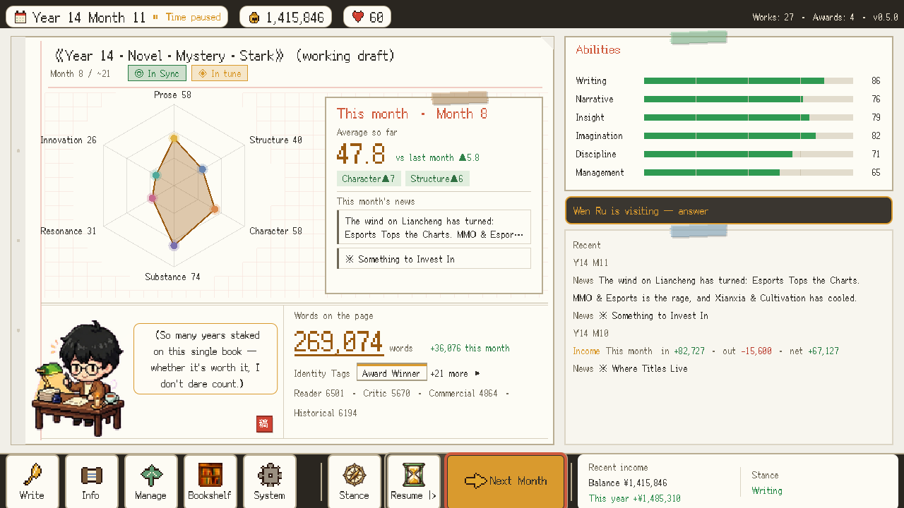</td>
<td width="50%">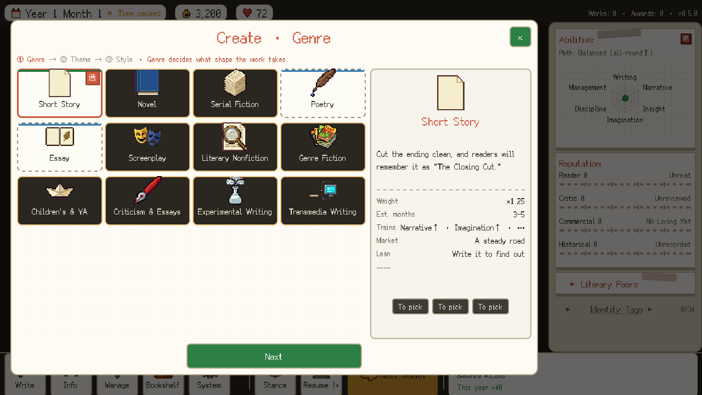</td>
</tr>
<tr>
<td><b>写书。</b>六维雷达逐月生长；「本月」卡片说明这个月哪里涨了、为什么涨。能力、字数和本月消息环绕四周。</td>
<td><b>选体裁。</b>十二种体裁，开局大多锁着——解锁取决于你实际写过什么，而不是等级。</td>
</tr>
<tr>
<td>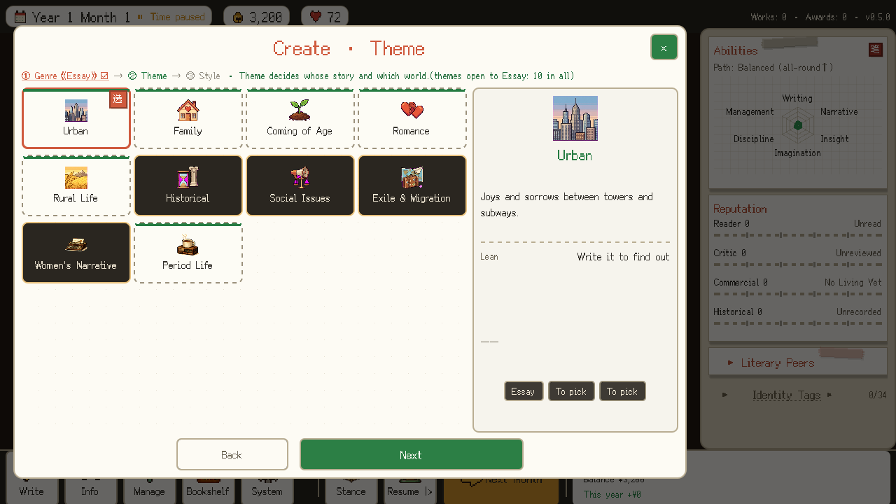</td>
<td>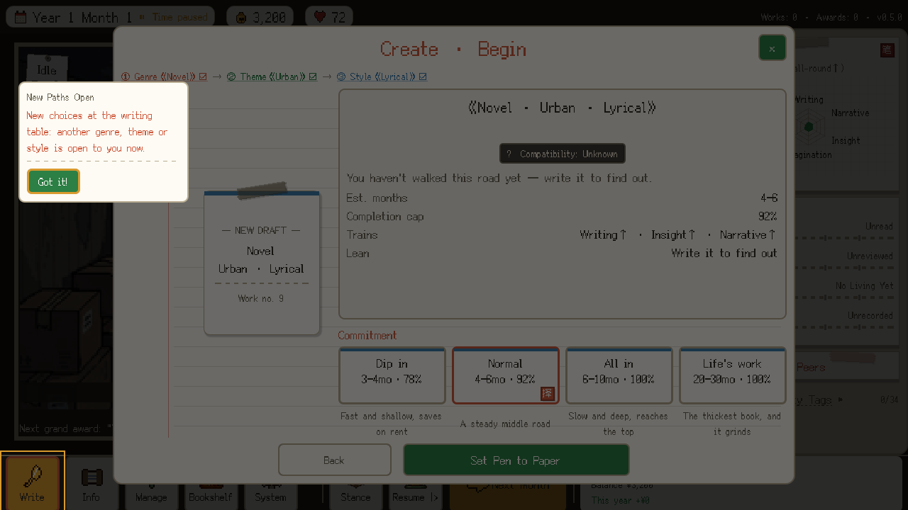</td>
</tr>
<tr>
<td><b>每一轴都会收窄下一轴。</b>题材列表按刚选的体裁筛选，所以创作是一个向导，而不是三个下拉框。</td>
<td><b>落笔前最后一步。</b>「相性：未知——写了才知道」。篇幅与野心决定完成度上限。左侧小卡是只出现一次的教学卡。</td>
</tr>
<tr>
<td>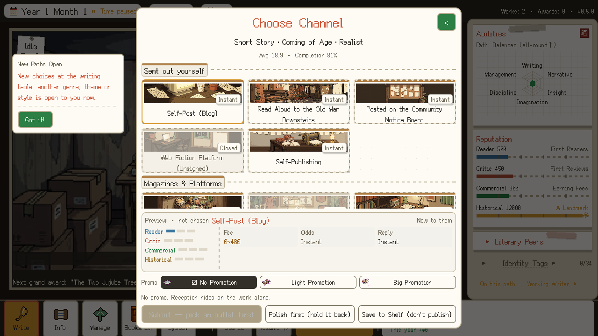</td>
<td>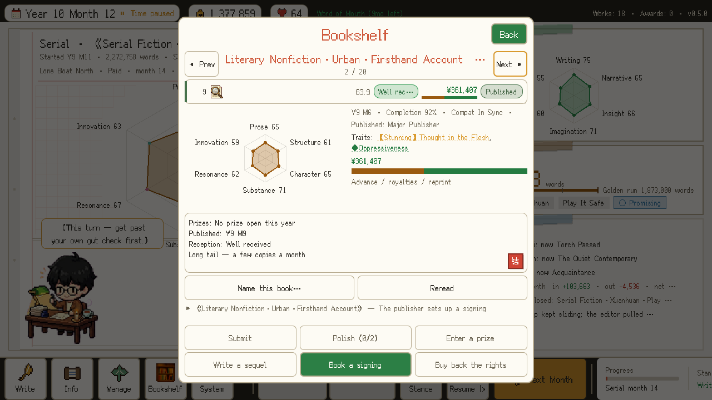</td>
</tr>
<tr>
<td><b>投到哪里。</b>渠道是有性格的地方，不是梯子上的一格。「先打磨」和「压在书架上」都是真实选项。</td>
<td><b>每本书都有一份书档</b>：分数、按来源拆分的收入、还能报名的奖，以及六个还能对它做的动作。灰掉的动作会说明原因。</td>
</tr>
<tr>
<td>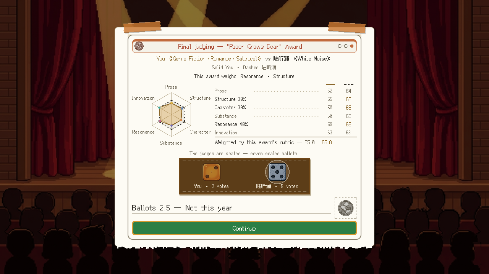</td>
<td>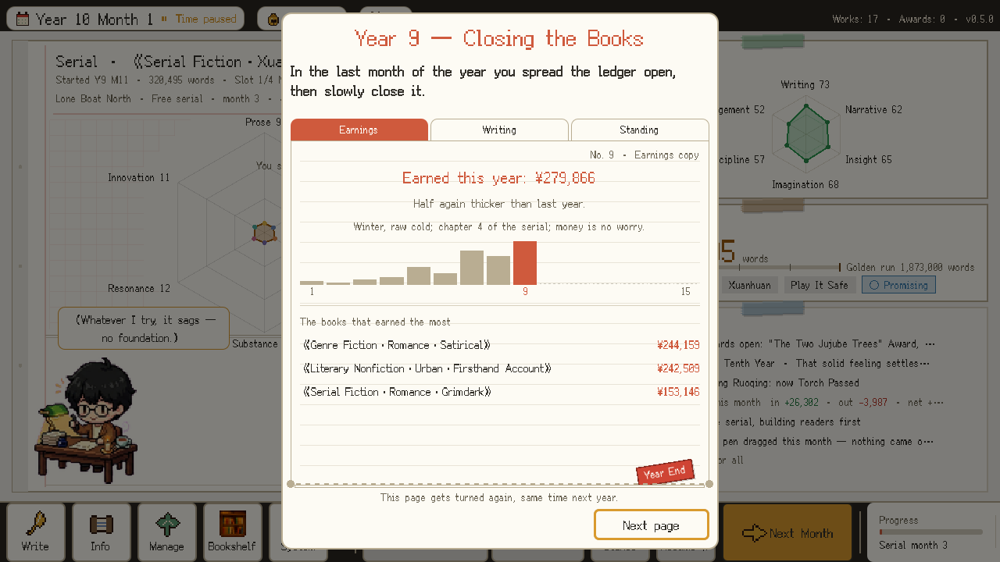</td>
</tr>
<tr>
<td><b>终审。</b>两本书叠在一张雷达上，按该奖标准加权，七张密封选票。这本以 2:5 落选，屏幕说清了输在哪里。</td>
<td><b>每年十二月像结账一样收尾</b>：按书拆分的收入、写了多少字、站在什么位置。十五页这样的账，就是一段生涯。</td>
</tr>
<tr>
<td>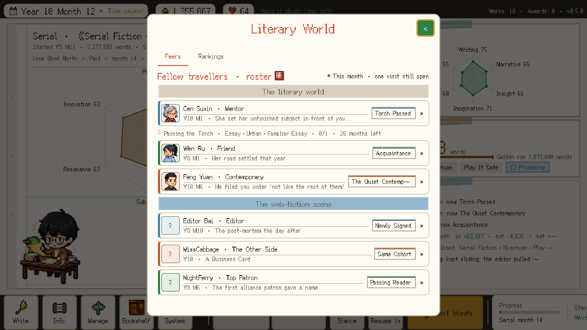</td>
<td>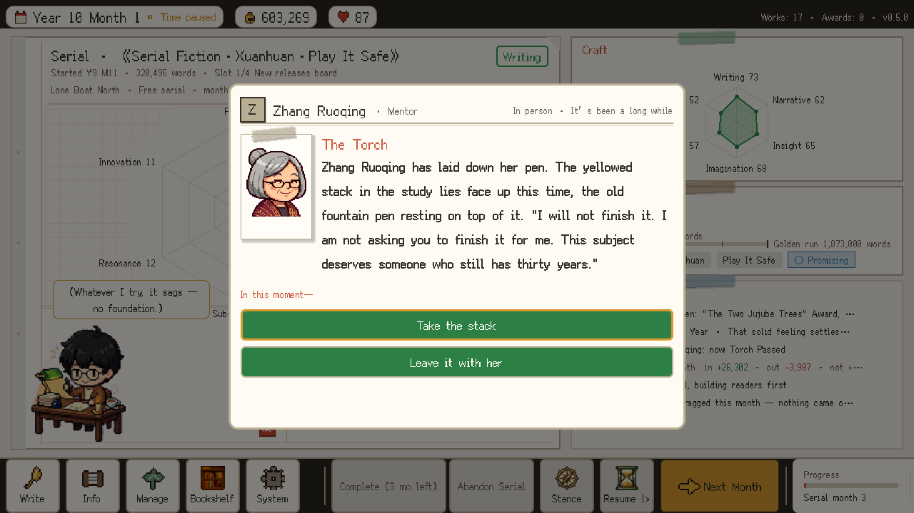</td>
</tr>
<tr>
<td><b>文坛。</b>游戏根据你最近几本书判断你在哪条赛道（带迟滞，一次尝试不会改掉你的标签），故事线随之走向。</td>
<td><b>一段剧情。</b>三段关系里一共约一百段，每段都由你真实生涯的条件触发。</td>
</tr>
<tr>
<td>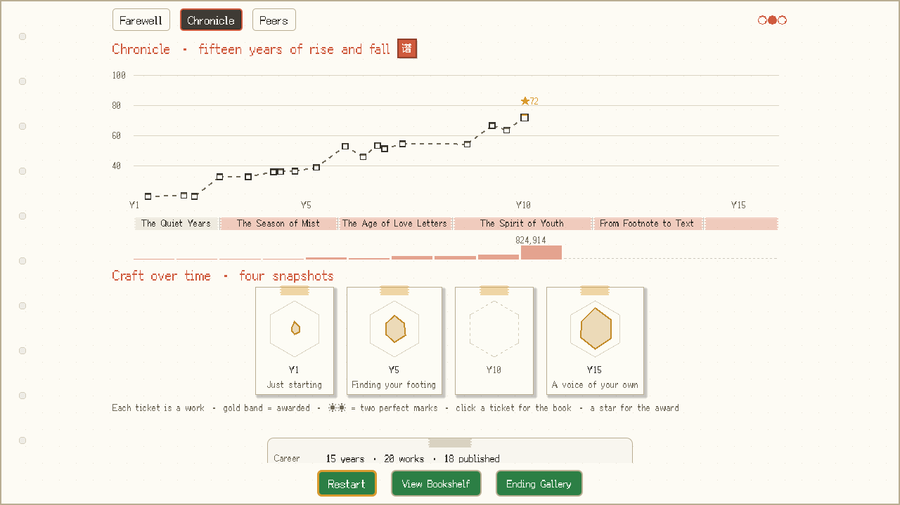</td>
<td>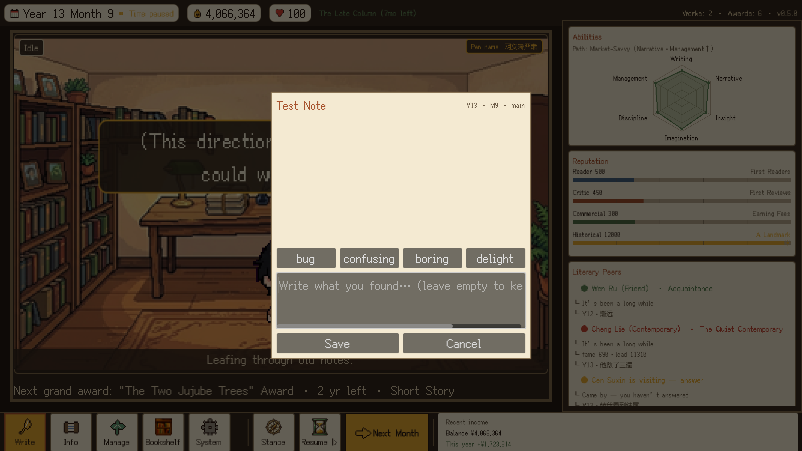</td>
</tr>
<tr>
<td><b>年谱。</b>每本发表的书是曲线上的一张书票，每个奖是一颗星，点开就是那本书的书档。十五年的形状只有在这里看得见。</td>
<td><b>我给自己做的工具：</b>试玩中按一个键就能写一条带标签的笔记，自动附上截图和当刻的完整存档。100 轮试玩全部经由它记录。</td>
</tr>
</table>

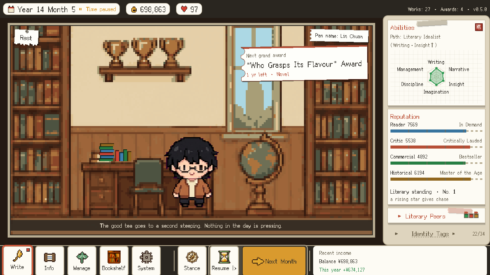 
同一个存档的英文版。界面标签在运行时按当前语言自适应尺寸，布局测试对每种语言各跑一遍。

## 设计思路

**设计支柱**

1. **有意思的决定是审美上的。** 多数生涯模拟是套了主题的最优化游戏。写作不像求最大值，更像先决定写什么，再看
   世界怎么回应它。
2. **形状在回望中出现。** 单个月份很小，十五年连起来才是一个只能从结尾读懂的故事——年关账本、年谱和结局都围绕
   这一点来做。
3. **用游戏自己的口吻解释。** 卡片上写一句有性格的话，而不是一排数值；机制在第一次用到时教一次，之后不再重复。

**流程：** 概念 → 系统拆分 → 每个系统一份设计文档 → 架构决策记录 → 实现。独立项目里文档不是为了交接，而是让矛盾
在写代码之前暴露，也让 AI 代理的产出有东西可对照检查。设计文档里数字过时算缺陷：任何改动行为的提交都要同批更新
文档，好几条自动检查专门盯这件事。

## 技术架构

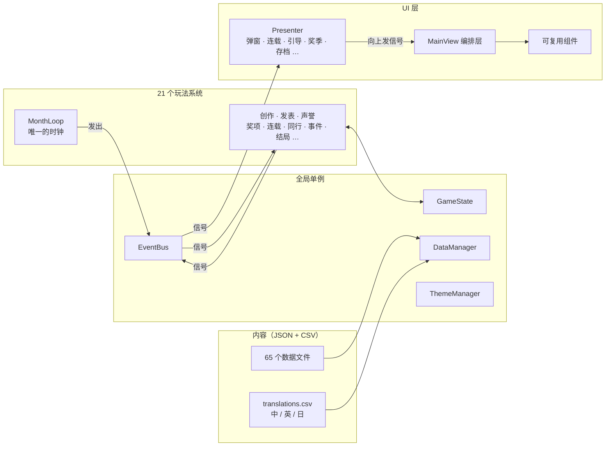

- **系统之间从不直接调用。** 每个玩法系统都是独立文件里的一个节点，只通过事件总线上的信号交流；月循环是唯一的
  时钟。任何系统都能单独构造、发信号来测试，测试框架正是这么做的。
- **UI 是独立的一层。** 界面控制器不碰玩法系统，只监听同一条总线，并向上给唯一的编排视图发信号。编排视图变大后，
  按职责拆出多个 Presenter，CI 用单文件行数上限强制执行。
- **内容即数据。** 体裁、题材、风格、特性、事件、渠道、结局、成就和 NPC 故事线全部写在 JSON 里。触发条件是字符串
  （如 `works_published>=2 and signed_ever>=1`），由**唯一一个共享的条件解析器**解释；构建时有检查拒绝未知词——数据
  文件里的笔误会让构建失败，而不是悄悄让一段剧情永远触发不了。
- **本地化是结构性的。** 从第一行代码起，所有玩家可见文字都走 `tr()`。git 里只有 CSV 一个真源，编译出的翻译文件
  每次导入时重新生成，永不提交。
- **该确定的地方就确定。** 市场时代、月度排名、奖项竞争场和对手都是 `(种子, 月份)` 的纯函数：重开窗口数字不变，
  第 94 个月的 bug 可以从第 1 个月重放出来。
- **文案可往返编辑。** 约 10 万字中文分散在一个 CSV 和几十个 JSON 里，一条命令导出成按读者习惯分组的 38 册
  「书」；改完再导入，每处改动精确写回原字段，带冲突检测，并自动排队等待英文、日文跟进。

## 难题与解法

以下都是这个项目里真实遇到的问题，以及原因和现在防止它复发的办法。

**1. 中文放得下，英文和日文就破版。**
*问题：* 英文、日文字符串经常比中文原文宽很多，标签被截、按钮变大、窗口超出屏幕。*原因：* 布局只靠肉眼、只看一种
语言、一种分辨率。*解法：* 建立**适配门**：每个窗口和多步流程在 720p、1080p、超宽屏下按每种语言各开一遍，窗口超屏、
标签被容器截断、主按钮在步骤间移位都算失败。测试数据必须喂**最长的真实字符串**——喂短字符串的测试会一直绿，真游戏却在坏。

**2. 「改了文案，发出去的还是旧的」。**
*问题：* 改过的文字有时不出现在游戏里。*原因：* 编译后的翻译文件被提交进仓库，会悄悄过期。*解法：* 让过期产物
不可能存在——只提交 CSV，翻译文件作为构建产物每次导入重新生成。一整类 bug 就此消失，不需要任何额外纪律。

**3. 关不掉的窗口。**
*问题：* 偶发软锁。*原因：* 两套独立的浮层系统（场景内窗口与弹窗队列）可能同时打开。*解法：* **浮层互斥测试**，
断言在游戏能产生的所有序列里两套浮层永不同时出现。

**4. 键盘玩家被困住，甚至崩溃。**
*问题：* 一次纯键盘通关找出六个够不到的控件；还有一次崩溃，是两套焦点收容机制互相抢焦点直到进程崩掉。*解法：*
把崩溃变成可断言的失败；再用**键盘走查器**借引擎自己的焦点解析，对每个界面做焦点邻居的广度优先遍历，断言每个控件
都可达。新窗口必须在同一次改动里加入走查名册。

**5. 每次读数都「正常」，难度却在漂移。**
*问题：* 连续四次改动各自都在「上一次读数的误差内」，加起来却让难度偏移了两个多百分点。*解法：* 把「跑到顶级结局
的局数占比」作为唯一的难度总闸，用 480 局脚本跑测，和**存成文件的、拍板过的基线**比：参照永远是基线中心，而不是
上一次读数；连续三次偏同一侧就算系统性偏移，不算噪声；改了调参文件却没重测，CI 直接变红。

**6. 只在老存档上出现的 bug。**
*解法：* **存档博物馆**——旧版本的真实存档冻结保存、永不重新生成，每次测试都读档、再存、继续往下玩。存档格式是唯一
跨版本的契约。

**7. 测试崩了却还打印 PASS。**
*问题：* 某个探针中途脚本报错，跳过后面所有断言，照样打印成功。*解法：* 测试输出里出现任何脚本错误都算失败；每道
测试都要报告「心跳数」——实际跑到了多少条检查——绿灯必须是真的跑出来的。

**8. 一个最近的完整案例：「对手的数值为什么都是 36？」**
试玩时发现，前期文学奖终审对手的六项数值一模一样。*根因：* 奖项界面借用了切磋系统生成对手的「形状」函数，而切磋
系统后来加了一个最低 50 分的下限——前期玩家低于这条线，六项先被压平再缩放，于是整排同数。一个系统的调参通过共享
函数泄漏到了另一个系统。*修法：* 奖项界面改为自己生成形状，并加测试断言六项不会齐平；接受修复前先确认撤掉修复时
测试会变红。同一轮还发现一条旧测试其实是靠 55% 概率的随机数恰好没命中才通过的，现在改成确定性的。

**9. 新手教程没教最要紧的东西。**
*问题：* 以第一次玩的玩家视角复查新手引导，发现金钱、心力、日期和「十五年」这个目标从没被高亮过；而且「跳过引导」
会把以后所有提示一起关掉。*解法：* 引导从 32 步增加到 34 步，高光顶栏这四样东西；跳过时可以选择是否保留提示；
原本只在引导里讲的内容补上兜底提示卡，只对跳过引导的玩家出现；另补四张首次遇到时的说明卡。每次 CI 都有脚本把 34 步
真实点击走一遍。

## 测试与质量保障

一条命令约三分钟跑完全部测试并返回有意义的退出码；每次推送 CI 在 Linux 上重跑一遍，专抓单台 macOS 开发机抓不到的
问题（大小写敏感路径、没提交的资源、只有干净克隆才会重新生成的构建产物）。

| 阶段 | 证明什么 |
|---|---|
| 逻辑扫描 + 启动 | 对每个系统做白盒断言（无界面运行），主场景无错误加载 |
| 适配门 × 3 种语言 | 每个窗口在中英日三语、720p / 1080p / 超宽屏下都放得下 |
| 浮层互斥 | 两套浮层永不同时打开 |
| 焦点测试 | 复现过的焦点崩溃不再出现；每个控件都能用键盘到达 |
| 界面与数据对账 | 屏幕上*写的*与数据层*算的*一致 |
| 引导走查 | 34 步引导真实点击：聚光框对准正确控件，点击落在屏幕说可点的地方 |
| 存档博物馆 | 老存档能读、能存、能继续玩 |

另外有一个**脚本玩家**用固定种子无界面地跑完整的十五年局，支撑三件事：上面的**平衡测量**；十三种玩法风格下哪些
内容真正触发过的**覆盖矩阵**（连续两次战役都没触发的内容进孤儿名单）；以及**叙事一致性检查**——记录展示给玩家的每一行
文字和当刻的世界状态，发现矛盾就判失败，比如正在写书却被说「停笔了」、颁奖前就被祝贺获奖、同一屏出现同一句话两次。

**内容检查**覆盖代码测试管不到的部分：孤儿翻译键、生成文档与源头不同步、三种语言里与角色性别不符的代词、低于
对比度标准的文字，以及误留在玩家可见字段里的作者备注。

## 以试玩驱动迭代

游戏已经过 **100 轮有记录的试玩**。循环如下：

1. 以玩家身份试玩，用大白话写下哪里不对——用游戏内记录器（笔记 + 截图 + 完整存档）。
2. 把每条抱怨变成一个可以被证伪的命题：「宿敌感觉很疏远」→「有没有任何代码路径能让这段关系超过 40？」
3. 用附带的存档复现，找到根因，在共享代码里修一次。
4. **钉住它：** 不加一条「撤掉修复就会失败」的检查，就不算修完。
5. 同一次提交里更新设计文档。

因为每条笔记都带完整存档，「第十二年左右感觉不太对」也能变成可复现的案例——本页的截图就是读这些存档拍的。

## AI 辅助开发

项目以 **Claude Code** 作为主要开发代理：代理负责大部分敲代码，我负责定规格、做裁决和验证。

- **并行代理做广度**（每个子系统一个，要求每个结论都标出文件和行号，找不到就说找不到，不许猜）；它们的发现只当线索，
  验证后才行动。
- **持久化的项目记忆**记录规则和踩过的坑，让经验跨会话、跨模型保留。
- **接入运行中游戏的实时检查桥**，让代理读取真实运行状态、拍真实截图，而不是推测代码大概会怎样。
- **模型分工：** Opus 负责架构、调试和审查；Sonnet 处理大批量机械改动；Fable 起草文案，再由我编辑，让几千段短文保持
  同一个声音。早期我还在本地用 **Ollama 跑 Qwen3 4B** 做翻译，摸清了小模型的上下文长度在哪里开始不够用。

**它会自信地出错**——都是这个仓库里的真事：同步脚本假设了键的顺序，把一个文件里的每条数据都错位了一格；新写的检查
规则第一次跑就太宽松；代理相信过时的设计说明而不是代码；shell 管道吞掉了失败的退出码、报告全绿；六条被标记的问题
以「已审过」为由一次性加进白名单，其中一条恰恰是这道检查要抓的 bug。没有一条是语法错误——每一条都自洽，只是在某个
没人复核的事实上错了。所以这个项目的工作规则是：坏数字被观测到变好才算修完；新检查必须先故意弄坏、亲眼看它变红，才
相信它的绿；仪器报出离谱的结果时，先怀疑仪器。

这种方式的杠杆是真实的——同样时间里，这个项目远比我手写能做到的更大、测试更充分——但它把人的工作推向上游：判断
什么是真的，并搭建能一直证明它的机制。

## 收获与心得

- **围绕决定来设计，而不是围绕数值。** 把核心选择定成审美上的，改变了下游的一切——界面文案、解锁节奏，甚至失败的
  呈现方式。
- **测试本身就是产品。** 每个测试阶段都是因为某类 bug 漏进了试玩才加上的；测试从 5 个阶段 / 18 秒长到 10 个阶段 /
  约 3 分钟，每一步都有来由。
- **先让坏状态无法存在，再谈纪律。** 不再提交翻译二进制文件，比任何检查清单都管用。
- **没亲眼见过它失败的检查只是摆设。** 给每道新检查做反向验证，抓出了好几道根本不可能变红的检查。
- **共享函数带着隐性耦合。** 最难的那些 bug，大多是一处改动通过两边共用的代码悄悄改变了另一处。

## 进度与计划

- ✅ 可完整通关：180 个月、21 个结局、两条文学路线、三条 NPC 故事线全部实现。
- ✅ 三语界面、键盘 / 手柄支持、四套主题、Windows 与 macOS 导出流程、Steam 接入。
- 🔧 进行中：真人完整通关后的平衡调整、最小音频包、英文与日文的母语校对。
- 🗓 计划：Steam 商店上架。

## 源码与联系方式

源码和美术资源**不公开**，本仓库只有这份说明和截图。如因招聘需要，可提供私有仓库的只读权限；也很乐意讲解任何一个
系统——测试框架、数据驱动的内容管线、本地化方案，或 NPC 故事线引擎。

**李博文 Bowen Li** · [github.com/Bli18](https://github.com/Bli18)
